 

---

## 🌌 Mon Holy Graph

  
   
  🟢 validé · 🔵 disponible · ⚫ à venir

---

## 📈 Progression

| Cercle | Projet | Statut |
|:------:|:-------|:------:|
| **0** | [**Libft**](./libft) | ✅ Validé |
| **1** | ft_printf | 🔓 Disponible |
| **1** | get_next_line | 🔓 Disponible |
| **1** | push_swap | 🔓 Disponible |
| **2** | Born2beroot · A-Maze-ing · Exam Rank 02 | 🔒 À venir |
| **3** | Fly-in · Codexion · Call Me Maybe · Exam Rank 03 | 🔒 À venir |
| **4** | NetPractice · Pac-Man · Exam Rank 04 | 🔒 À venir |
| **5** | Inception · Exam Rank 05 | 🔒 À venir |
| **6** | ft_transcendence · Exam Rank 06 | 🔒 À venir |

 

1 / 18 étapes validées

---

---

## Compétences

---

**Hanane** · haait-ba · 1337

